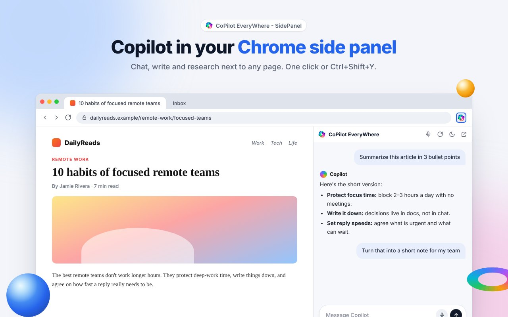

# CoPilot EveryWhere - SidePanel

**Copilot in Chrome's side panel, next to every page.**

A Chrome extension that opens Copilot in Chrome's side panel or a popup. Summarize, write, translate and code without switching tabs.

👉 **[Add to Chrome](https://chromewebstore.google.com/)** · 🌐 **[Website](https://sidepaneldev.github.io/copilot-everywhere/)** · 🔒 **[Privacy](https://sidepaneldev.github.io/copilot-everywhere/privacy.html)** · 🛟 **[Support](https://github.com/sidepaneldev/copilot-everywhere/issues)**

## ✨ Features
- 🧭 Copilot sidebar for Chrome: chat next to the page
- 🪟 Side panel or popup, your choice
- ⌨️ `Ctrl+Shift+Y` (`⌘+Shift+Y` on Mac)
- 🎙️ Voice input
- 🌗 Light & dark theme
- 🌍 55 languages
- 🔒 No ads, no tracking: it never reads the pages you visit

---

CoPilot EveryWhere is an independent extension and is not affiliated with Microsoft. "Microsoft" and "Copilot" are trademarks of their respective owners.

© 2026 SidePanel developer. All rights reserved. This repository hosts the project website only.
